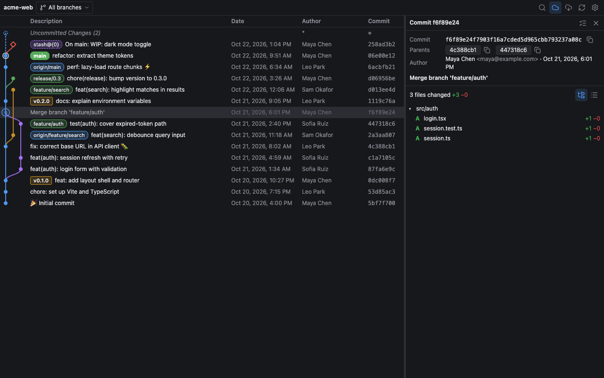
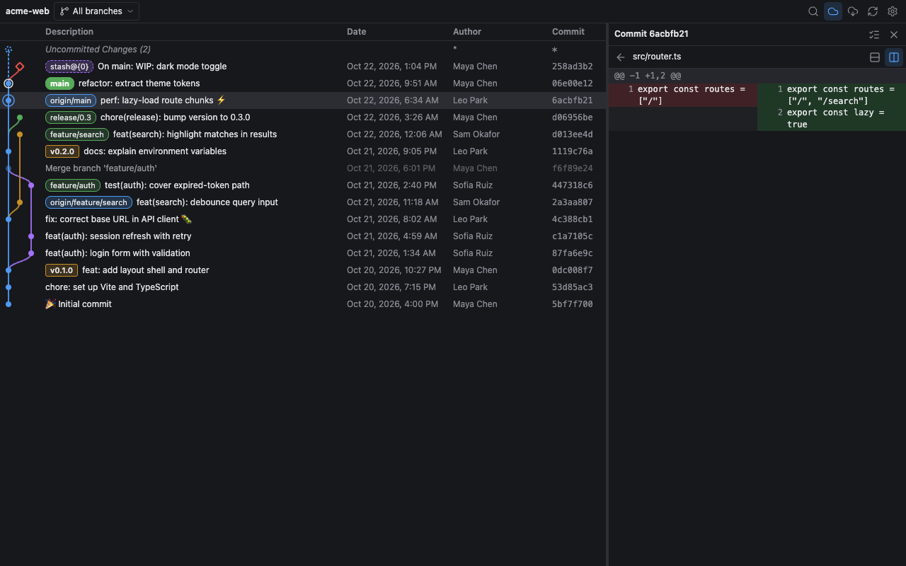
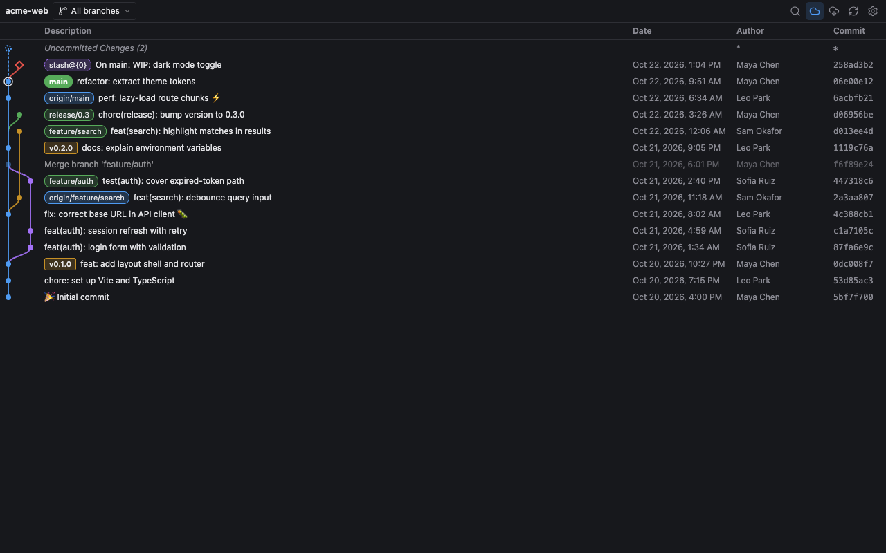
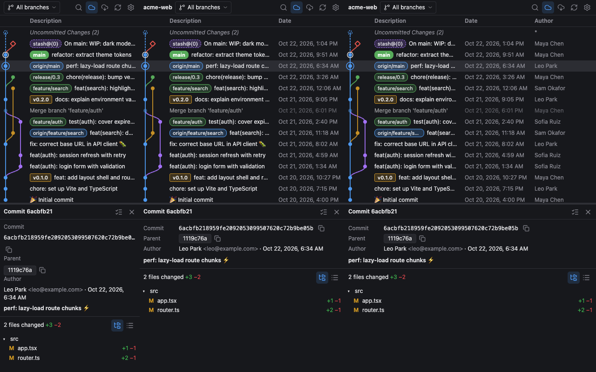

<p align="center">
  
</p>

<h1 align="center">Git Graph for Orca</h1>

<p align="center">
  A commit graph for the focused workspace's repository, right in Orca's sidebar.<br>
  Browse history, inspect commits and diffs, and run everyday Git actions without leaving the editor.
</p>

<p align="center">
  <a href="LICENSE"></a>
  = 1.4.248" src="https://img.shields.io/badge/orca-%E2%89%A51.4.248-4f9cf9.svg">
  <a href="https://github.com/tuna-etech/gitgraph-orca/releases"></a>
</p>



## Contents

- [Features](#features)
- [Install](#install)
- [Usage](#usage)
- [Settings](#settings)
- [Permissions](#permissions)
- [Development](#development)
- [Project layout](#project-layout)
- [Contributing](#contributing)
- [Acknowledgements](#acknowledgements)
- [License](#license)

## Features

**Graph**

- Branches, merges and stashes drawn as coloured lanes (rounded or angular).
- Labels for local and remote branches, tags (annotated in bold), stashes and the checked-out branch. `main` and `origin/main` on the same commit are combined into one label.
- An *Uncommitted Changes* row that updates as you edit files.
- Branch filter with local branches, remote branches and your own glob patterns.
- Find (`⌘F` / `Ctrl+F`) across messages, hashes, authors, dates and refs, with case and regex options.
- Hover a commit dot to see whether HEAD contains it and which branches and tags do.
- Loads 300 commits at first and more as you scroll. Rows are virtualised, so long histories stay fast.
- Refreshes when `.git` or the working tree changes. Files ignored by Git do not trigger a refresh.

**Commit details and diffs**

- Author, committer, parents (click one to jump to it), signature status, and the message with links and issue references.
- Changed files as a tree or a list, with `+`/`−` counts and renames.
- Inline or side-by-side diff, the file at any revision, and diff against your working copy.
- Compare any two commits with `⌘`/`Ctrl`+click, or a commit with your uncommitted changes.
- Code review mode: files you have not opened yet stay bold until you view them.



**Git actions** (right-click a commit, branch, tag, stash or the uncommitted row)

| Target | Actions |
| --- | --- |
| Branch | Checkout, rename, delete (optionally on remotes too), merge (fast-forward, no-ff, squash), rebase, interactive rebase, push to one or more remotes, create pull request |
| Remote branch | Checkout as local (reuses an existing local branch and offers to pull it), pull, merge, fetch into a local branch, delete |
| Commit | Create branch, add tag, checkout, cherry-pick, revert, drop, reset (soft, mixed, hard), download as zip or tar |
| Tag | View details, push, delete locally and on a remote |
| Stash | Apply, pop, drop, create a branch from it |
| Uncommitted | Stash, reset, clean untracked files |

Destructive actions ask for confirmation first. If a push or fetch needs credentials, the plugin offers to rerun the command in an Orca terminal.



**Repository settings**

Manage remotes (add, edit, fetch, prune, delete), set your user name and email locally or globally, turn issue numbers into links, and configure pull requests for GitHub, GitLab, Bitbucket or a custom URL template. The configuration can be exported to `.orca/git-graph.json` so your team shares it.

**Fits any panel size**

The toolbar uses icon buttons with tooltips. Columns hide themselves when space runs out, and labels collapse to `+N`. The details pane sits to the right of the graph on wide panels and below it on narrow ones.



## Install

You need Orca 1.4.248 or newer and Git on your `PATH`.

**From the community catalog:** open **Settings → Plugins**, search for **Git Graph** and choose **Install**.

**From the Git URL:**

1. Open **Settings → Plugins → Add plugin → From a Git URL…**
2. Paste `https://github.com/tuna-etech/gitgraph-orca#v1.0.3`, replacing the tag with the [latest release](https://github.com/tuna-etech/gitgraph-orca/tags).
3. Review the permissions it asks for (see [Permissions](#permissions)), then enable it.

## Usage

Open the **Git Graph** panel from the right sidebar. It shows the repository of the focused workspace and follows you when you switch workspaces. If the repository has submodules, pick one from the dropdown in the toolbar.

| Key | Action |
| --- | --- |
| `⌘F` / `Ctrl+F` | Find |
| `⌘H` / `Ctrl+H` | Scroll to HEAD |
| `⌘R` / `Ctrl+R` | Refresh |
| `⌘S` / `Ctrl+S`, add `Shift` to go back | Next or previous stash |
| `↑` / `↓` | Previous or next commit while details are open |
| `⌘↑` / `⌘↓` (`Ctrl` on Windows and Linux), add `Shift` to follow the other branch | Child or parent commit |
| `Esc` | Close the dialog, menu, diff or details |

Right-click a column header to show or hide the Date, Author and Commit columns, and drag a header's edge to resize it.

## Settings

All settings are under **Settings → Plugins → Git Graph**.

| Group | Settings |
| --- | --- |
| Display | Graph style, branch colours, label alignment, combined local/remote labels, details location, muted merge commits |
| Dates and loading | Date format (including ISO), author or commit date, commit order (date, author date, topological), first parent only, initial and per-page commit counts, automatic loading, scroll to HEAD on open |
| Content | Remote branches, tags, stashes, uncommitted changes, untracked files, working-tree watching, `.mailmap`, signature status, avatars |
| Fetch and custom | Prune and prune tags on fetch, custom branch glob patterns, custom emoji shortcodes |
| Dialog defaults | Initial choices in the create branch, add tag, merge, pull, rebase, delete branch, cherry-pick, stash and reset dialogs |

Avatars are off by default. When you turn them on, the plugin sends an MD5 hash of each author's email to Gravatar.

## Permissions

Git Graph is a `trusted-worker` plugin: its worker runs Git on your machine with your user's access. It asks Orca for:

| Capability | Used for |
| --- | --- |
| `workspace:read` | Finding the focused workspace and its repository |
| `workspace:write` | Opening a changed file in an Orca editor tab |
| `terminal:send` | Running interactive rebase, or a push or fetch that needs credentials, in an Orca terminal |
| `storage:own` | Remembering column widths, filters, code reviews and repository settings |
| `settings:own` | Reading the settings above |

The panel itself runs in Orca's sandboxed frame with no file system or network access. Every Git command runs in the worker with an argument list (no shell), and `GIT_TERMINAL_PROMPT=0` keeps Git from waiting on a password prompt.

## Development

```sh
pnpm install
pnpm types        # write Orca's typings to .orca/types (Git-ignored)
pnpm watch        # rebuild the panel on save
pnpm dev          # in a second terminal: load the folder into Orca and reload on change
```

Orca transpiles the worker (`src/worker/main.ts`) when it loads, so the worker needs no build. The panel is bundled by esbuild into `dist/panel/`. `dist/` is committed because Orca installs the plugin folder as it is and runs no build.

Before sending a change:

```sh
pnpm typecheck    # panel and worker tsconfigs
pnpm test         # orca plugin test .: worker tests against real temporary repositories
pnpm validate     # orca plugin validate .
pnpm build        # make sure dist/ matches the source
```

## Project layout

| Path | What it is |
| --- | --- |
| `orca-plugin.json` | Manifest: one HTML panel, settings and capabilities |
| `src/shared/protocol.ts` | Typed contract for every request between the panel and the worker |
| `src/shared/settings.ts` | Setting defaults and allowed values, shared by both sides. Must match `contributes.settings` |
| `src/worker/` | Node worker: repository lookup, Git commands (`git/`), file watching, storage, avatars |
| `src/panel/` | Preact panel: graph layout and SVG (`graph/`), table, toolbar, details pane, actions and dialogs (`components/`) |
| `scripts/build.mjs` | Panel build (`--watch` to rebuild on save) |
| `assets/` | Plugin icon (`icon.svg` is the source of `icon.png`) and screenshots |

The worker finds the repository by matching the focused workspace's name and branch against `workspace.list`, because `workspace.readContext` does not include a path. Two workspaces with the same name on the same branch cannot be told apart.

## Contributing

Bug reports and pull requests are welcome. Please read [CONTRIBUTING.md](CONTRIBUTING.md) first. For anything larger than a small fix, open an issue so we can agree on the approach before you write code.

## Acknowledgements

The feature set follows [Git Graph for VS Code](https://github.com/mhutchie/vscode-git-graph) by mhutchie. Its licence does not allow distributing derivative works, so this plugin is a separate implementation that shares no code with it. Icons are from [Lucide](https://lucide.dev) (ISC).

## License

[MIT](LICENSE) © 2026 Tu_SE
